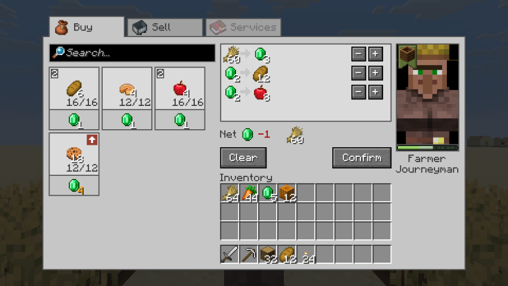
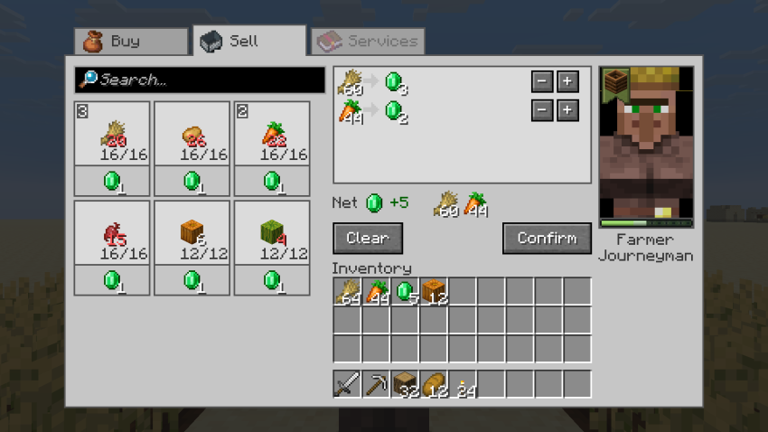
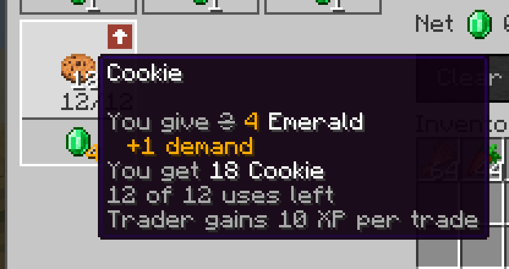
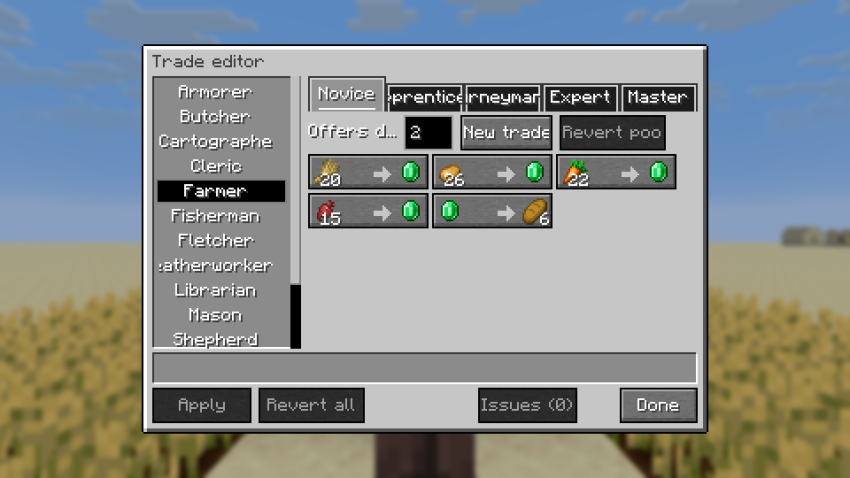

# Realistic Trading Overhaul

**Trade with villagers the easy way:** put everything you want in a cart, see what it costs, and
trade it all with one click. Admins get a trade editor to change what villagers offer, right in the
game.

Realistic Trading Overhaul is a NeoForge mod by Reality Craft Interactive. Download it from
[CurseForge](https://www.curseforge.com/minecraft/mc-mods/realistic-trading-overhaul). This
repository is where you get help, report problems and read the
[wiki](https://github.com/Reality-Craft-Interactive/realistic-trading-overhaul-support/wiki).

## Features

- **Shopping cart.** Add as many trades as you want and trade them all with one click.
- **Buy and Sell tabs.** One tab shows what the villager sells, the other what the villager buys from you.
- **Sell and buy in one go.** What you sell pays for what you buy, so you only pay what is left over.
- **Meet the trader.** See who you are trading with, their job and level, and how close they are to the next level.
- **Villagers and wandering traders.** The screen opens for both.
- **Trade editor for server admins.** Change what villagers and wandering traders offer, right in the game.

Everything else stays like normal Minecraft. Prices, villager levels, your statistics and your
advancements all work just as if you had made every trade by hand.

## How to trade

Right-click a villager, pick the **Buy** or **Sell** tab, click offers to put them in the cart, and
press **Confirm**. Nothing is traded until you do. The
[Cart Trading guide](https://github.com/Reality-Craft-Interactive/realistic-trading-overhaul-support/wiki/Cart-Trading)
has every click and shortcut.

## For server admins

Type `/rto editor` to open the trade editor. Pick a job and a level, then change what each trade
costs and gives, or add, copy and remove trades. Changes start working after a server restart. The
[Trade Editor guide](https://github.com/Reality-Craft-Interactive/realistic-trading-overhaul-support/wiki/Trade-Editor)
explains every field.

## Current release status

The recommended build is **0.3.0**, for Minecraft 26.3 and NeoForge 26.3.0.84 or later. It redesigns
the trading screen and replaces the 0.2.0-alpha.1 preview. The server and every player need the same
version. Download it from
[CurseForge](https://www.curseforge.com/minecraft/mc-mods/realistic-trading-overhaul). See the
[release history](wiki/Release-History.md) for every published file.

## Get help

- **Read the wiki first:**
  [Installation](https://github.com/Reality-Craft-Interactive/realistic-trading-overhaul-support/wiki/Installation),
  [Troubleshooting](https://github.com/Reality-Craft-Interactive/realistic-trading-overhaul-support/wiki/Troubleshooting),
  [FAQ and known issues](https://github.com/Reality-Craft-Interactive/realistic-trading-overhaul-support/wiki/FAQ-and-Known-Issues),
  [Supported versions](https://github.com/Reality-Craft-Interactive/realistic-trading-overhaul-support/wiki/Supported-Versions)
  and [Release history](https://github.com/Reality-Craft-Interactive/realistic-trading-overhaul-support/wiki/Release-History).
- **Found a bug or a crash?**
  [Open an issue](https://github.com/Reality-Craft-Interactive/realistic-trading-overhaul-support/issues/new/choose)
  and pick the form that fits.
- **A question or an idea?** Ask in
  [Discussions](https://github.com/Reality-Craft-Interactive/realistic-trading-overhaul-support/discussions).
- **How reports are handled:** see [SUPPORT.md](SUPPORT.md).
- **A security problem?** Report it through
  [private vulnerability reporting](https://github.com/Reality-Craft-Interactive/realistic-trading-overhaul-support/security/advisories/new),
  not a public issue. See [SECURITY.md](SECURITY.md).

## Distribution

> This repository does **not** contain the mod's source code or downloadable JARs. Development is
> private. Official binaries are distributed only through CurseForge.

Realistic Trading Overhaul is All Rights Reserved under a custom license. Unmodified CurseForge
modpack inclusion is allowed when CurseForge supplies the file through its approved dependency and
distribution systems. See [LICENSE](LICENSE) and the [modpack policy](wiki/Modpack-Permission.md).

Pull requests containing mod code are not accepted here. Documentation corrections can be reported
as issues.
